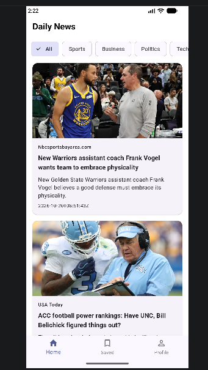
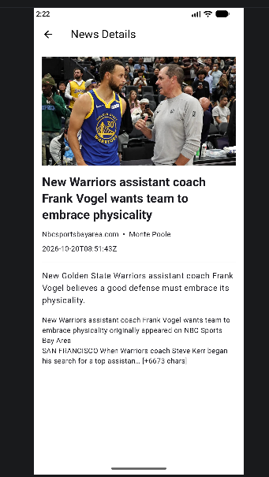

# Daily News App

A Flutter news app that fetches headlines from NewsAPI and displays them by category. The app supports a home feed, category filters, article detail view, and a simple refresh/load-more pattern.

## Screens

### 1. Home Screen

- Displays the main news feed
- Includes category chips for:
  - All
  - Sports
  - Business
  - Politics
  - Technology
  - Entertainment
  - Health
  - Science
- Loads news on startup and supports refresh and pagination
- 

### 2. News Details Screen

- Opens when a news card is tapped
- Shows the article title, source, author, date, description, and content
- Displays the article image if available
- 

## Tech Stack

- Flutter
- Dart
- BLoC pattern
- Dio + Retrofit for API calls
- NewsAPI

## Project Structure

- `lib/main.dart` — app entry point
- `lib/core/` — constants and API client setup
- `lib/features/news/data/` — models, repository, and remote API
- `lib/features/news/presentation/bloc/` — BLoC state management
- `lib/features/news/presentation/screens/` — app screens
- `lib/features/news/presentation/widgets/` — reusable UI widgets

## Prerequisites

- Flutter SDK installed and configured
- Android Studio / Xcode / emulator device, or a connected device
- A valid NewsAPI key

## Setup

1. Install dependencies:

   ```bash
   flutter pub get
   ```

2. If generated files are missing or stale, run:

   ```bash
   flutter pub run build_runner build --delete-conflicting-outputs
   ```

3. Add your NewsAPI key as a compile-time environment variable:

   ```bash
   flutter run --dart-define=NEWS_API_KEY=YOUR_NEWS_API_KEY
   ```

   Example:

   ```bash
   flutter run --dart-define=NEWS_API_KEY=1234567890abcdef
   ```

## Run the app

### Android / emulator / connected device

```bash
flutter run --dart-define=NEWS_API_KEY=YOUR_NEWS_API_KEY
```

### Run in release mode

```bash
flutter run --release --dart-define=NEWS_API_KEY=YOUR_NEWS_API_KEY
```

### Run tests

```bash
flutter test
```

## Notes

- The app expects the `NEWS_API_KEY` environment variable to be set before launch.
- The NewsAPI key is read from `lib/core/constants.dart` and passed through the HTTP client in `lib/core/dio_client.dart`.
- Some category queries may return empty results depending on the source and current live data, so the app includes fallback searches for empty category responses.

## Useful Commands

```bash
flutter doctor
flutter pub get
flutter run --dart-define=NEWS_API_KEY=YOUR_NEWS_API_KEY
flutter test
```
